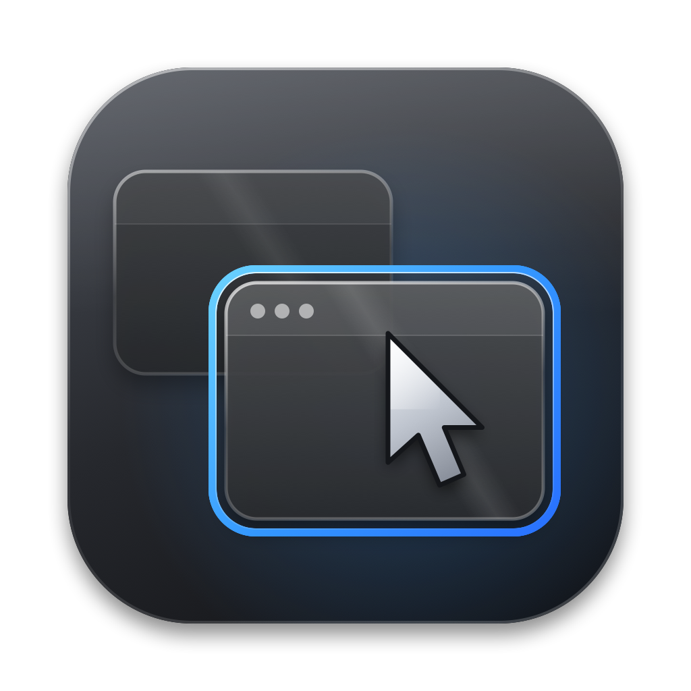

<div align="center">



# HoverFocus

**Focus follows your mouse on macOS.**<br>
Hover a window, click once, done.

<br>

[](https://github.com/jhrahman/HoverFocus/releases/latest/download/HoverFocus.dmg)

[](https://github.com/jhrahman/HoverFocus/releases/latest)
[](https://github.com/jhrahman/HoverFocus/releases)
[](#install)
[](#install)
[](Sources/HoverFocus)
[](LICENSE)
[](https://github.com/jhrahman/HoverFocus/stargazers)

</div>

HoverFocus is a tiny menu bar app for macOS. Move your mouse onto a window, wait a moment, and that window is ready for your next click. No more clicking twice.

Windows has had this for years as "Activate a window by hovering over it with the mouse". macOS never did, so I built it.

## Download

Grab the latest `HoverFocus.dmg` from the [Releases page](https://github.com/jhrahman/HoverFocus/releases/latest), or use the blue button at the top. You need macOS 13 Ventura or newer. It runs on both Apple silicon and Intel Macs. Install steps are [below](#install).

## Why this exists

If you use a Mac with an external monitor, you have probably hit this. A video is playing on the second screen, you are working on the first one, and you click the video to pause it. Nothing happens. You click again and it works.

The first click did not do what you asked. It only told macOS to bring that window into focus, and then the click was thrown away. Every time you jump between screens, you pay a click.

With HoverFocus running, the window under your cursor gets focus as soon as you rest on it, so your first click is the real one. It works on every display, no matter which one is your main display, and it works with any app.

## What you get

- Focus follows the mouse across all your displays and all your apps
- By default windows stay where they are. The hovered window gets focus, but it does not jump in front of the others while you move the mouse
- A setting to bring the hovered window to the front if you prefer that
- A hover delay you can set to Instant, 100 ms, 250 ms (the default), 500 ms or 1000 ms
- Launch at Login
- A menu bar icon, plus an optional Dock icon
- It leaves the Dock, the menu bar, open menus and system security prompts alone, and it does nothing while you are dragging something
- No network access, and it collects nothing
- One universal build for Apple silicon and Intel

## Install

### From the DMG

1. Download `HoverFocus.dmg` and open it.
2. Drag HoverFocus into the Applications folder.
3. Open HoverFocus from Applications.
4. Give it Accessibility permission (see [below](#give-it-accessibility-permission)).

### From the .app

1. Copy `HoverFocus.app` into your Applications folder.
2. Open it. If you launch it from anywhere else, it asks whether to copy itself into Applications.
3. Give it Accessibility permission (see [below](#give-it-accessibility-permission)).

### If macOS refuses to open it

I sign the app myself and it is not notarized by Apple, so macOS may block the first launch of a downloaded copy. This is normal for apps that are not distributed through Apple. To get past it:

1. Try to open the app once, then close the warning.
2. Go to System Settings, then Privacy & Security.
3. Scroll down to the Security section and click **Open Anyway** next to HoverFocus.
4. Confirm, then open the app again.

On older versions of macOS you can also right click the app, choose **Open**, and confirm.

## Give it Accessibility permission

macOS only lets an app focus windows that belong to other apps if you allow it under Accessibility. HoverFocus uses the permission for that and nothing else.

1. Go to System Settings, then Privacy & Security, then Accessibility.
2. Switch HoverFocus on. If it is not in the list, click **+** and add `/Applications/HoverFocus.app`.
3. The HoverFocus window should now say "Accessibility access granted".

One thing to know: when you replace the app with a newer version, macOS sometimes treats it as a different app and quietly drops the permission. If hovering stops working after an update, select HoverFocus in the Accessibility list, remove it with **-**, and add it again.

## Settings

| Setting | What it does |
| --- | --- |
| Enable HoverFocus | Turns hover focus on or off right away |
| Hover delay | How long the cursor has to rest on a window before it gets focus |
| Bring hovered window to front | Off: the window gets focus and stays where it is. On: it also comes in front of other windows |
| Launch at Login | Starts HoverFocus when you log in |
| Start hidden at login | Skips opening the settings window when it starts at login |
| Show Dock icon | Shows HoverFocus in the Dock |
| Show menu bar icon | Shows HoverFocus in the menu bar |

If you hide both icons, just open HoverFocus again from Applications and the settings window comes back.

## Things that do not work perfectly

- **Java apps like IntelliJ IDEA.** These apps pull their own window to the front the moment they receive focus, and macOS gives me no way to stop that. So for them HoverFocus only activates the app. Click inside the window before you start typing.
- **It relies on undocumented macOS functions.** macOS has no public way to give a window focus without also raising it. HoverFocus uses the same hidden window server calls as open source tools like AutoRaise and yabai. A future macOS update could break that. If it does, HoverFocus falls back to the normal Accessibility route, and hovered windows will come to the front.
- **No Mac App Store.** Apps that use private functions cannot be published there.
- **Spaces and full screen apps.** HoverFocus works on the windows you can see right now. It does not switch Spaces for you.

## Build it yourself

You need the Xcode Command Line Tools. If you do not have them, run `xcode-select --install`.

```sh
git clone https://github.com/jhrahman/HoverFocus.git
cd HoverFocus
./build.sh
```

That gives you `build/HoverFocus.app` and `build/HoverFocus.dmg`, both universal (arm64 and x86_64). To redraw the app icon, run `./Tools/make_icns.sh`.

```
Sources/HoverFocus/   the app, one file per job
Tools/                icon generator
Resources/            app icon
build.sh              builds the app and the DMG
```

## Troubleshooting

**Nothing happens when I hover.** Check that Accessibility access is granted and that Enable HoverFocus is switched on. The status badge in the settings window tells you which one is missing.

**One app still ignores my first click.** Some apps have their own ideas about focus. Turn on the log, reproduce the problem, then look at what HoverFocus did:

```sh
defaults write com.hoverfocus.app debug -bool true
cat ~/Library/Logs/HoverFocus.log
```

When you are done, turn the log off again with `defaults write com.hoverfocus.app debug -bool false`.

**Still stuck?** [Open an issue](https://github.com/jhrahman/HoverFocus/issues) and include the log from above.

**How do I remove it?** Quit HoverFocus from the menu bar, turn off Launch at Login, delete `/Applications/HoverFocus.app`, and remove it from the Accessibility list.

## License

HoverFocus is released under the [MIT License](LICENSE).
